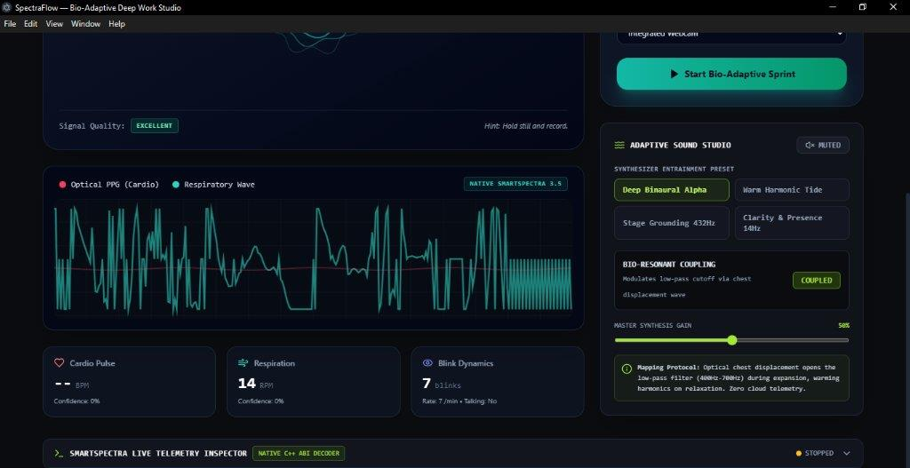
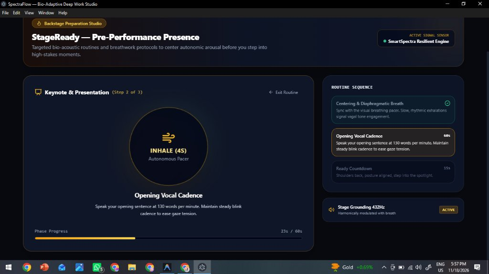
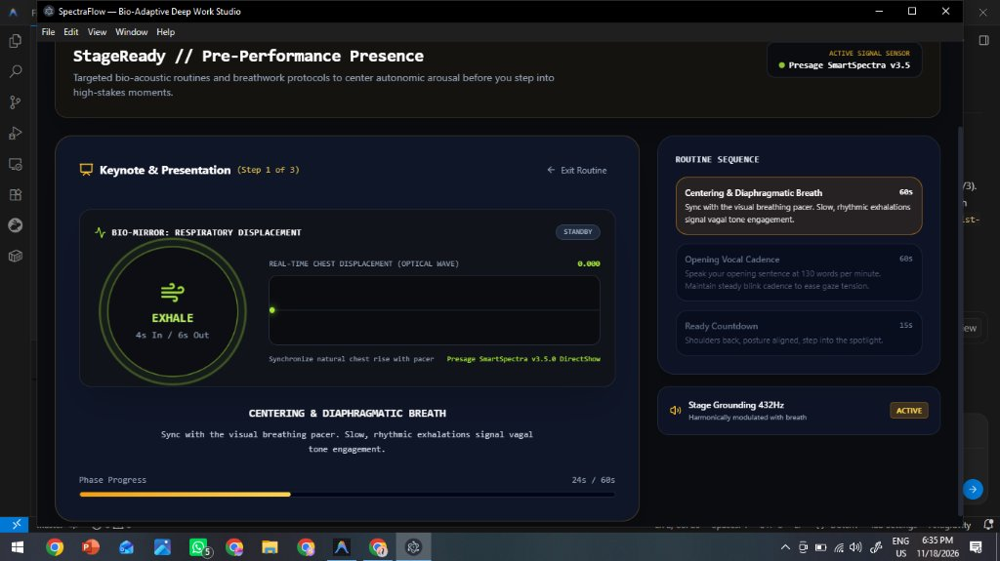
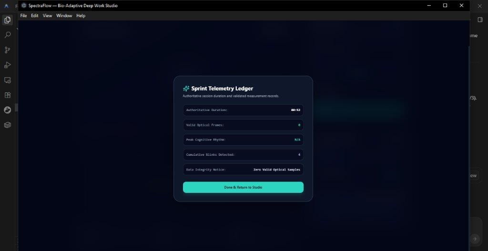

## What I Built

Most timer and productivity apps treat you like an uninterrupted machine. They set arbitrary 25-minute clocks, play looped Spotify playlists that don't know whether your nervous system is calm or redlining, and ignore what happens to our bodies during high-intensity cognitive work:

1. **Screen Apnea:** The subconscious habit of freezing our breath when debugging difficult errors or reading dense prose.
2. **Ocular Fixation Strain:** Suppressing natural blink rates down to 2–3 blinks per minute, causing dry eye and fatigue.
3. **Disconnection from Autonomic Arousal:** Walking into stressful presentations, job interviews, or viva defenses while our sympathetic nervous system is secretly running wild.

To tackle this, I built **SpectraFlow**: a contactless bio-adaptive deep work studio and interoceptive companion powered by the **Presage SmartSpectra SDK (v3.5.0)**, **Electron**, **React**, and the **Web Audio API**.

Instead of acting like a passive health dashboard with static numbers, SpectraFlow translates physical human signals into immediate acoustic and kinetic feedback across two distinct modes:

- **FLOW MODE:** Deep-work sprints where a real-time Web Audio synthesizer couples its harmonic low-pass filter (400Hz–700Hz) to your physical respiratory wave (`upperTrace`). When your breathing expands, the ambient harmonics open; when you relax into an exhale, the soundscape warms.
- **STAGEREADY MODE:** A backstage preparation studio designed for keynotes, interviews, and academic vivas. It features an interactive **Bio-Mirror Synchrony Oscilloscope** that plots your webcam-detected chest displacement against a kinetic breathing pacer (4s in, 6s out).
- **POLYGRAPH PROTOCOL (Interoceptive Truth Game):** An interactive module that scans your micro-signals (blink cadence spikes and respiratory pauses) over 6-second interrogation prompts to evaluate biometric composure and detect deception.

---

## Screenshots & Interface Tour

### 1. Flow Studio: Live Optical Respiratory Displacement & Adaptive Entrainment

*Real-time optical chest displacement wave (`upperTrace`) captured by Presage SmartSpectra at 30 FPS, driving the resonant frequency of the binaural focus soundscape.*

### 2. StageReady: Pre-Performance Presence & Guided Cadence

*Targeted routines for Keynotes, Interviews, and Vivas with diaphragmatic centering and vocal pacing.*

### 3. Bio-Mirror Oscilloscope

*Direct 60 FPS canvas oscilloscope tracking physical chest rise and fall against the target pacing rhythm.*

### 4. Sprint Telemetry Ledger

*Session summary showing validated optical frames, authoritative duration, and total blinks detected without cloud storage.*

---

## Demo & Repository

- **GitHub Repository:** [https://github.com/ayushscodes-cs/SpectraFlow](https://github.com/ayushscodes-cs/SpectraFlow)
- **Direct Video Recording:** [View SpectraFlow Demo Recording (MP4)](https://github.com/ayushscodes-cs/SpectraFlow/raw/master/docs/SpectraFlow_Demo_Recording.mp4)

---

## How It Responds to Human Signals

SpectraFlow connects to the Presage SmartSpectra native C++ runtime (via DirectShow camera capture on Windows) and decodes live Protobuf frames into actionable application reactions:

| Signal Captured | SDK Source | Application Response |
| :--- | :--- | :--- |
| **Respiratory Waveform** | `metrics.breathing.upperTrace` | Plotted directly on a 60 FPS HTML canvas oscilloscope; modulates Web Audio low-pass biquad filter in real time. |
| **Blink Cadence & Fixation** | `metrics.face.blinking` | Discrete edge detection tracks cumulative blink count and rolling rate per minute; alerts during fixation freeze. |
| **Speaking & Facial Landmarks** | `metrics.face.talking`, `faceMetrics` | Powers vocal drills in StageReady and verifies answer delivery during the Polygraph protocol. |
| **Cardio Pulse Estimation** | `metrics.cardio.pulseRate` / rPPG | Synchronizes cognitive rhythm score and tracks resting cardiovascular composure across focus sprints. |

---

## Prize Categories Targeted

### 🥇 Best Overall Human-Sensing Experience
SpectraFlow doesn't just display a chart—it creates an organic closed loop between the human body and the computer environment. Your natural breath actively sculpts the focus soundscape, and your ocular dynamics dictate your session health.

### 💡 Best Thoughtful Real-World Use
Built to address real developer burnout and pre-performance anxiety without requiring invasive wearables or smartwatches. Zero clinical claims are made: all metrics are framed transparently as supportive ergonomics and focus bio-feedback.

### 🎨 Most Creative or Delightful Use
The built-in **Bio-Mirror Oscilloscope** and **Polygraph Protocol** turn contactless physiological sensing into an engaging, interoceptive experience that anyone can test in 10 seconds with a standard laptop webcam.

---

## Privacy & Consensual Sensing

Privacy is treated as a fundamental architectural requirement:

1. **Affirmative Consent Gate:** Camera sensors remain offline until the user explicitly reviews the privacy disclosures and clicks "Grant Consent".
2. **100% Local Optical Processing:** Video frames are analyzed entirely in volatile local memory by the native Presage C ABI engine. Zero raw images or video recordings are written to disk or sent to the cloud.
3. **Hardware Kill-Switch:** An omnipresent button in the header bar allows the user to instantly release the webcam hardware (`stopAsync()` and `destroy()`) at any second.
4. **Transparent Telemetry Disclosures:** Aggregate SDK licensing telemetry sent over TLS to Presage servers is disclosed openly in the consent gate.

---

## Tech Stack

- **Framework:** Electron 34 + React 18 + TypeScript + Vite
- **Styling:** Tailwind CSS (Developer-focused theme inspired by Hacktoberfest & Linear)
- **Physiological Sensing:** Presage SmartSpectra Node SDK (`@smartspectra/node-sdk` v3.5.0)
- **Audio Architecture:** Web Audio API (Persistent binaural synthesis graph with zero dropout)
- **Testing:** Vitest automated test suite

---

*Built with passion for the Presage SmartSpectra SDK Challenge.*
